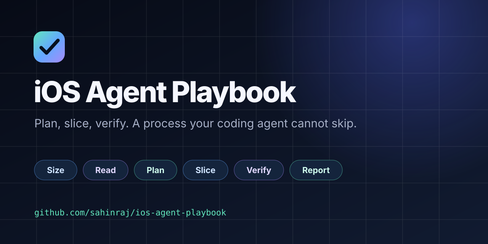

# iOS Agent Playbook



[](https://github.com/sahinraj/ios-agent-playbook/actions/workflows/validate.yml)
[](https://github.com/sahinraj/ios-agent-playbook/releases/latest)
[](LICENSE)

A planning, slicing and verification playbook for AI coding agents doing iOS, iPadOS and macOS work in Swift, SwiftUI and SwiftData. It is one skill with five modes that makes the agent size the risk, read the project before planning, work in small verified slices, and report with evidence instead of "should work". It runs in Claude Code and in GitHub Copilot (VS Code, Copilot CLI, Copilot for Xcode).

Version 1.0.0, November 2026.

This is an independent community project and is not affiliated with or endorsed by Apple, GitHub, Microsoft, or Anthropic.

[Website](https://sahinraj.github.io/ios-agent-playbook/) · [Latest release](https://github.com/sahinraj/ios-agent-playbook/releases/latest) · [Report an issue](https://github.com/sahinraj/ios-agent-playbook/issues) · Companion: [iOS Swift Master](https://github.com/sahinraj/ios-swift-master-copilot)

## Why this exists

Most failed iOS changes from coding agents are process failures, not knowledge failures:

- editing before reading the deployment target, Swift language mode or default actor isolation
- fixing a symptom without reproducing the bug
- one large diff that mixes a refactor, a feature and a migration
- a SwiftData schema change that passes every test and crashes at launch for existing users
- silencing a concurrency diagnostic with `@unchecked Sendable` to get a green build
- "done" without a build

A playbook does not make a model smarter. It makes it disciplined, and that is the part cheaper models get wrong most often. It also gives you a clean way to split work between models: let your strongest model map the repo and plan the hard tasks, then let a cheaper one execute the plan slice by slice. See [guides/model-handoff.md](guides/model-handoff.md).

## Quick start

One line. It installs for Claude Code and Copilot, whichever you have:

```bash
curl -fsSL https://sahinraj.github.io/ios-agent-playbook/install.sh | bash
```

Pick one tool, or install into a repo for Copilot for Xcode and your team:

```bash
curl -fsSL https://sahinraj.github.io/ios-agent-playbook/install.sh | bash -s -- personal --claude
curl -fsSL https://sahinraj.github.io/ios-agent-playbook/install.sh | bash -s -- project ~/path/to/YourApp
```

The script clones the repo into `~/.ios-agent-playbook` (override with `IOS_PLAYBOOK_HOME`), verifies the package and runs `install.sh` with your arguments. Run it again any time to update. If you'd rather read the script first, see [docs/install.sh](docs/install.sh) or use the manual install below.

Then, in your iOS repo:

```text
/ios-playbook map
/ios-playbook fix the crash when an inspection is deleted during sync
```

Claude Code users can also install it as a plugin, with no script:

```text
/plugin marketplace add sahinraj/ios-agent-playbook
/plugin install ios-playbook@ios-agent-playbook
```

Plugin skills are namespaced, so the command is `/ios-playbook:ios-playbook`. The installer gives you the shorter `/ios-playbook`.

## The loop

Every task goes through the same six steps. Step 0 decides how much of the rest it gets.

| Step | What the agent does |
|---|---|
| 0. Size | Picks trivial, standard or high risk, and says why. A typo fix stays cheap. A shipped schema change, an isolation change, sync, signing or user data is high risk and waits for your OK. |
| 1. Read | Collects facts with file paths: settings, schemes, the pattern in use, the data path, a baseline build and test run. For a bug, a reproduction and a hypothesis before any fix. |
| 2. Plan | Goal, out of scope, assumptions marked verified or unverified, slices with their gates, and the specific things the compiler will not catch. Shown before the first edit. |
| 3. Slice | One concept per slice, each building and passing on its own. A refactor or a migration never shares a slice with anything else. |
| 4. Verify | Runs the gates that apply, in order, and stops at the first failure. |
| 5. Report | What changed, the command and result behind every claim, what was not verified, and what was noticed but left alone. |

### The nine gates

| # | Gate | Applies when |
|---|---|---|
| 1 | Build for the real destination, no new warnings in touched files | always |
| 2 | Targeted tests, with an executed count above zero | tests cover the area |
| 3 | A test for new logic that fails before and passes after | logic changed |
| 4 | A migration test that opens a store written by the previous schema | a persisted schema changed |
| 5 | No new diagnostics or silencers, tests pass under Thread Sanitizer | isolation or `Sendable` changed |
| 6 | UI walk: largest text size, both orientations, narrow iPad window, dark mode, VoiceOver labels | anything visible changed |
| 7 | Previews compile and render | a view changed |
| 8 | Diff audit script plus a read of the diff as a reviewer | always |
| 9 | Full unit test plan, compared with the baseline | once, before the report |

Two rules do most of the work. If the same failure survives two different fix attempts, the agent stops and re-reads instead of guessing a third time. And if a gate cannot be run, it is listed as not verified, with the command for you to run. It is never reported as passed.

### Five modes, one command

| Command | What it does |
|---|---|
| `/ios-playbook map` | Reads the repo and writes `.playbook/repo-map.md` (working build commands, settings, layout, patterns) and `.playbook/risk-map.md` (where changes break silently). No source edits. |
| `/ios-playbook plan <task>` | Plan only, saved to `.playbook/plans/<name>.md`, written so another model or a fresh session can execute it without making design decisions. |
| `/ios-playbook execute <plan file>` | Carries out a saved plan one verified slice at a time. Stops if the plan no longer matches the code. |
| `/ios-playbook verify` | Runs the gates on the current working tree and reports. No source edits. |
| `/ios-playbook <task>` | The whole loop. |

## What's inside

```
ios-agent-playbook/
├── install.sh                              Installer (personal, project, uninstall, verify)
├── skills/ios-playbook/
│   ├── SKILL.md                            The loop, modes, gates and hard rules (under 200 lines)
│   ├── references/                         Loaded on demand, only when a task needs them
│   │   ├── sizing.md                       Levels, examples, why each trigger is high risk
│   │   ├── reading-the-repo.md             Where each fact lives, baselines, patterns, data paths
│   │   ├── planning.md                     Plan fields, slicing recipes by change type, plan files
│   │   ├── silent-failures.md              What the compiler will not catch, and how to check each
│   │   ├── verification-gates.md           Commands, log filtering and evidence for every gate
│   │   ├── bug-protocol.md                 Reproduce, isolate, explain, fix, regress, by symptom
│   │   ├── swiftdata-changes.md            Shipped stores, versioned schemas, the migration test
│   │   ├── concurrency-changes.md          Isolation changes, the fix ladder, Swift 6 migration order
│   │   ├── repo-map.md                     How map mode builds the repo map and risk map
│   │   ├── handoff.md                      Plan and execute modes, the advisor, model pairing
│   │   └── examples.md                     Filled-in plans at each level, and a finished report
│   ├── assets/                             Templates: plan, report, repo map, risk map, pointer block
│   └── scripts/
│       ├── project-facts.sh                Prints settings, schemes, persistence and concurrency facts
│       └── diff-audit.sh                   Lists what deserves a second look in the current diff
├── agents/ios-playbook.agent.md            "iOS Playbook" custom agent for Copilot
├── instructions/ios-playbook.instructions.md   Always-on process rules for **/*.swift
├── guides/model-handoff.md                 Strong model plans, cheaper model executes
├── evals/                                  Ten process tasks and a scorer (with vs without the skill)
├── tests/                                  Installer, bootstrap, script and eval harness tests
└── .claude-plugin/                         Claude Code plugin and marketplace manifests
```

Both scripts are read-only. They need only bash, grep, sed, awk and find, and run with the bash 3.2 and BSD tools that ship with macOS. CI runs the test suite on macOS and Linux.

In Claude Code the skill costs about 290 tokens of context until it is used, and about 4,500 when it loads. References are read only when a task needs them.

### How the pieces work together

| Piece | When it is used | Works in |
|---|---|---|
| Skill (`SKILL.md` + references + scripts) | Loaded automatically when a request matches the description, or on demand with `/ios-playbook` | Claude Code, VS Code, Copilot CLI |
| Custom agent | When you pick "iOS Playbook" in the agent menu | VS Code, Copilot CLI, Copilot for Xcode |
| `ios-playbook.instructions.md` | Every request that touches a `.swift` file | VS Code, Copilot for Xcode |
| Managed block in `CLAUDE.md`, `AGENTS.md` or `copilot-instructions.md` | Every request in the repo. Points the agent at the skill and at `.playbook/` | All of the above |
| `.playbook/repo-map.md`, `risk-map.md`, `plans/` | Written by the skill in your repo. Plain Markdown, so any tool, model or person can read them | Everything |

Copilot for Xcode supports custom agents and instruction files but does not document skills support. The agent is written to read the skill's files from `.github/skills/`, which is why a **project install** is the way to use this in Xcode.

## Requirements

- macOS with bash (the default shell setup is fine; scripts run with `/usr/bin/env bash`).
- One or more of:
  - Claude Code
  - VS Code with GitHub Copilot Chat
  - GitHub Copilot CLI
  - Copilot for Xcode 0.48.0 or later (for custom agents)
- For the verification gates: Xcode and a simulator. If a build tool such as XcodeBuildMCP or Xcode's own MCP tools is connected, the skill uses it in preference to raw `xcodebuild`. Without any of these the skill still plans and audits, and lists every gate it could not run.

## Step 1: Manual install (optional)

Skip this if you used the one-line install. The personal install symlinks back to this folder, so clone it somewhere permanent:

```bash
mkdir -p ~/Developer && cd ~/Developer
git clone https://github.com/sahinraj/ios-agent-playbook.git
cd ios-agent-playbook
./install.sh verify
```

`verify` should report the package as valid with 11 reference files. You can also download the zip from the [latest release](https://github.com/sahinraj/ios-agent-playbook/releases/latest).

## Step 2A: Personal install (all projects)

```bash
./install.sh personal
```

With no flags it installs for each tool whose home folder exists (`~/.claude`, `~/.copilot`), or for both if neither exists yet. It creates symlinks:

- Claude Code: `~/.claude/skills/ios-playbook`
- Copilot: `~/.copilot/skills/ios-playbook` and `~/.copilot/agents/ios-playbook.agent.md`

Options:

- `--claude` or `--copilot` to choose a tool explicitly. Both flags together install for both.
- `--copy` copies instead of symlinking, if a tool will not follow symlinks.
- `--force` replaces an existing folder you created yourself (the old one is backed up with a timestamp).

### Verify in Claude Code

Start Claude Code, type `/` and confirm `ios-playbook` is in the list. If `~/.claude/skills/` did not exist before the install, restart Claude Code once so it starts watching the folder.

### Verify in VS Code

1. Restart VS Code, open the Chat view and switch to Agent mode.
2. Type `/` and confirm `ios-playbook` is listed.
3. Open the agent dropdown and confirm "iOS Playbook" is listed.
4. If something is missing, right-click in the Chat view, select **Diagnostics**, and look for load errors.

### Verify in Copilot CLI

```text
copilot
/skills reload
/skills info ios-playbook
```

## Step 2B: Project install (required for Copilot for Xcode, recommended for teams)

```bash
./install.sh project ~/path/to/YourApp
```

With no flags it installs for each tool the repo already uses, or for both if it uses neither yet.

| Tool | Files copied into the repo |
|---|---|
| Claude Code (`--claude`) | `.claude/skills/ios-playbook/` and a managed block in `CLAUDE.md` (or in `AGENTS.md` if that exists and `CLAUDE.md` does not) |
| Copilot (`--copilot`) | `.github/skills/ios-playbook/`, `.github/agents/ios-playbook.agent.md`, `.github/instructions/ios-playbook.instructions.md` and a managed block in `.github/copilot-instructions.md` |

Files are copied rather than linked so they can be committed and so Xcode's sandbox can read them. Your existing content in the instruction files is preserved. Re-running the command updates everything in place.

### Use it in Copilot for Xcode

1. Update Copilot for Xcode to 0.48.0 or later.
2. Open the project folder in Xcode and make sure Copilot for Xcode can read the workspace.
3. Open Copilot Chat, switch to **Agent** mode, and pick **iOS Playbook** in the agent menu.
4. If it does not appear, open `.github/agents/ios-playbook.agent.md` in Xcode once, then check the menu again.

### Commit for your team

```bash
cd ~/path/to/YourApp
git status --short                 # see what the installer added
git add .github                    # Copilot files
git add .claude CLAUDE.md          # Claude Code files, if you installed them
git commit -m "Add the iOS Agent Playbook skill, agent and instructions"
```

Whether to commit `.playbook/` (the repo map, risk map and plans) is your team's call. To keep it local without touching `.gitignore`, add `.playbook/` to `.git/info/exclude`.

## Step 3: Use it

Start with the map. It is a one-time cost per repo and every later task is better for it:

```text
/ios-playbook map
```

Then give it work:

- `/ios-playbook fix the crash when an inspection is deleted while sync is running`
- `/ios-playbook add a status filter to the inspection list`
- `/ios-playbook plan make inspection numbers unique (the app has shipped)`
- `/ios-playbook execute .playbook/plans/unique-inspection-number.md`
- `/ios-playbook verify`
- With the agent selected in Copilot: `map this repo`, or just describe the task.

You will see the level and the plan before any edit, and a report with evidence at the end. Filled-in examples are in [skills/ios-playbook/references/examples.md](skills/ios-playbook/references/examples.md).

### Strong model plans, cheaper model executes

The plan file is the interface between models. A typical setup:

1. Your strongest model runs `map` once per repo, and `plan` for the hard tasks.
2. A cheaper model runs `execute` on the plan, one verified slice at a time.
3. If your tool supports it, the stronger model stays on call as an advisor at exactly three points: after a high-risk plan, when the same failure survives two attempts, and before a high-risk finish.

Setup for Claude Code, what it costs and how to keep that cost down are in [guides/model-handoff.md](guides/model-handoff.md).

### Pair it with a domain skill

The playbook is process only and does not teach Swift. For Swift 6, SwiftUI and SwiftData knowledge, install [iOS Swift Master](https://github.com/sahinraj/ios-swift-master-copilot) next to it. The two are designed to be used together: this one decides what to do and how to check it, that one knows how to write it.

## Helper scripts on their own

Both scripts are useful without an agent.

```bash
SCRIPTS=~/.ios-agent-playbook/skills/ios-playbook/scripts
"$SCRIPTS/project-facts.sh" ~/path/to/YourApp     # settings, schemes, persistence, concurrency

cd ~/path/to/YourApp
"$SCRIPTS/diff-audit.sh"                          # working tree against HEAD
"$SCRIPTS/diff-audit.sh" main                     # everything since the branch left main
```

`diff-audit.sh` lists, with file and line: new concurrency silencers, `try!` and `as!`, lint suppressions, disabled or removed tests, possible force unwraps, legacy concurrency, unstructured tasks, debug output, sleeps, changed `@Model` files and changed project, signing, privacy and CI files. Set `PLAYBOOK_AUDIT_STRICT=1` to make it exit 1 on blockers, for a pre-push hook or CI.

## Benchmark

`evals/` holds ten process tasks: a shipped schema change, a crash with no reproduction, a trivial edit that should stay trivial, an isolation change, a refactor mixed with a feature, the same error twice, a report from an environment that cannot build, and more. Each has checks for what a good answer contains and must avoid. Run the prompts with and without the skill, save the answers and compare:

```bash
evals/score.sh evals/results/baseline evals/results/with-skill
```

See [evals/README.md](evals/README.md). Results depend on the model, so this repo ships the tasks and not a headline number.

## Updating

```bash
curl -fsSL https://sahinraj.github.io/ios-agent-playbook/install.sh | bash        # one-line install: pulls the latest and re-links
cd ~/Developer/ios-agent-playbook && git pull && ./install.sh personal            # manual install
./install.sh project ~/path/to/YourApp                                            # re-copies, updates the managed blocks
```

## Uninstalling

```bash
./install.sh uninstall-personal
./install.sh uninstall-project ~/path/to/YourApp
```

Only files created by this installer are removed. Your own content in the instruction files stays, and so does your `.playbook/` folder.

## Customizing

- **Your team's risk triggers**: edit the list in step 0 of `SKILL.md`, and add the reasoning to `references/sizing.md`.
- **Your gates**: add a row to the gate table and a section to `references/verification-gates.md`, for example snapshot tests or a UI test plan.
- **Your build commands**: put them in `.playbook/repo-map.md`, not in the skill. The skill reads the map first.
- **Tighten the triggers**: edit `description` in `SKILL.md` (max 1024 characters). The skill loads based on this text.
- **Manual only**: add `disable-model-invocation: true` to the frontmatter so it runs only when you type `/ios-playbook`.
- **Team-specific protocols**: add a file under `references/` and a row in the reference table.

Run `./install.sh verify` after editing. It checks the description length, the line count and every link in `SKILL.md`.

## Troubleshooting

| Problem | Fix |
|---|---|
| Skill not listed | Folder name and `name:` must both be `ios-playbook`. Run `./install.sh verify`. In Claude Code, restart once if the skills folder is new. |
| Skill listed but not used on its own | Invoke it with `/ios-playbook`, or say "plan first" or "use the playbook". For always-on behavior, do a project install so the managed block is in the instruction file. |
| The agent over-plans small edits | It should size them as trivial. If it does not, start the request with "trivial:" or tighten step 0 for your team. |
| Scripts are not found | The skill refers to them as `${CLAUDE_SKILL_DIR}/scripts/...`. In tools that do not fill in that variable, the agent is told to look in the skill's `scripts/` folder. With a project install that is `.github/skills/ios-playbook/scripts/`. |
| Claude Code asks before running a helper script | Expected the first time. Both scripts are read-only, so you can allow them for the project. |
| Gates cannot run | No Xcode or simulator where the agent runs. The report lists them under "Not verified" with the commands. Run those yourself, or connect a build tool. |
| The advisor never fires | See the checklist at the end of [guides/model-handoff.md](guides/model-handoff.md). |
| Agent missing in Xcode | Update Copilot for Xcode, confirm `.github/agents/` exists in the opened folder, open the agent file once in Xcode. |
| Symlinked skill not found | Use `./install.sh personal --copy`. |
| "already exists and was not installed by this script" | Re-run with `--force`. Your folder is backed up. |

## Sources

- Claude Code skills: https://code.claude.com/docs/en/skills
- Claude Code advisor: https://code.claude.com/docs/en/advisor
- Claude Code plugins and marketplaces: https://code.claude.com/docs/en/plugins/manifest-reference
- VS Code Agent Skills: https://code.visualstudio.com/docs/agent-customization/agent-skills
- VS Code custom agents: https://code.visualstudio.com/docs/agent-customization/custom-agents
- Copilot CLI skills: https://docs.github.com/en/copilot/how-tos/copilot-cli/customize-copilot/add-skills
- The Swift Programming Language: https://docs.swift.org/latest/documentation/the-swift-programming-language/
- SwiftData: https://developer.apple.com/documentation/swiftdata
- Xcode build system and `xcodebuild`: https://developer.apple.com/documentation/xcode

The playbook is original guidance written from these sources and from experience shipping production iPad apps. Command syntax for Xcode tools shifts between releases, so when a command in `verification-gates.md` is not recognized, check the tool's own help and fix your repo map.

## Contributing and license

Contributions are welcome. See [CONTRIBUTING.md](CONTRIBUTING.md) for the checks to run. This project is available under the [MIT License](LICENSE).
